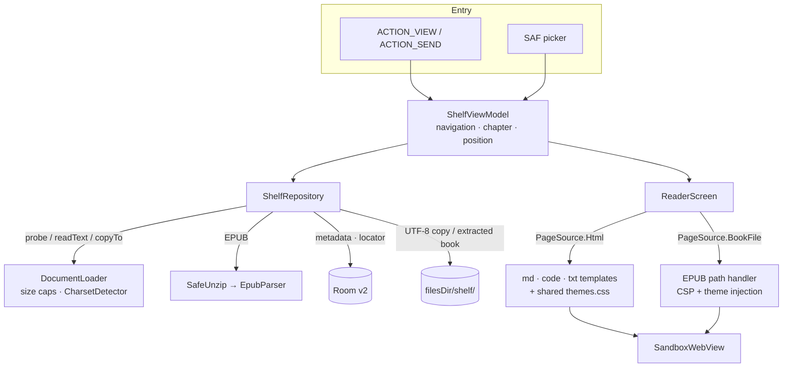

# YHViewer

**A lightweight, sandboxed Android reader for what AI tools produce (HTML, Markdown and code), plus TXT and EPUB books.**

[](https://github.com/Zer0Rin/yhviewer/actions/workflows/ci.yml)
[](https://github.com/Zer0Rin/yhviewer/releases/latest)


Screenshots are native API 37 emulator captures of curated fictional documents. The sandbox capture shows a real 9/9 result; temporary-network-permission evidence is linked below.

| Shelf | HTML | Markdown | Code | EPUB | Sandbox test |
|---|---|---|---|---|---|
|  |  |  |  |  |  |

**[Releases](https://github.com/Zer0Rin/yhviewer/releases)**: the tag-triggered workflow builds a signed R8 APK, checks its final permissions and smoke-tests startup before publishing. The first official release is pending signing setup and real-device smoke testing; see [RELEASE.md](RELEASE.md) and [release preparation evidence](docs/verification/RELEASE_PREPARATION.md).

---

## Why

AI assistants increasingly answer with **HTML instead of Markdown**: sortable tables, collapsible sections, charts, small interactive tools. Around those pages they also produce code, configs, logs and long Markdown notes. On a desktop you open them in a browser or an editor. On Android it's awkward:

- Mobile browsers handle local files poorly (`content://` URIs, no history, no library).
- A plain WebView wrapper needs deliberate restrictions on permissions, settings, resource loading and navigation to isolate untrusted pages.

YHViewer treats every file as **untrusted content**, renders it in a locked-down WebView, and keeps it on an offline shelf. Since the same sandbox and shelf work for long-form reading, it also reads TXT and EPUB books.

## Features

| Type | What you get |
|---|---|
| **HTML** | Rendered as-is in the sandbox. External links open in the system browser only on a real tap |
| **Markdown** | markdown-it + highlight.js, bundled offline. Raw HTML inside Markdown is shown as text |
| **Code** | File-type detection, line numbers excluded from copied text, wrap toggle and bundled syntax highlighting. Compact JSON up to 500,000 characters is formatted; large files skip highlighting and render in 200-line chunks |
| **TXT** | Encoding auto-detected (UTF-8 / GBK / Big5), chapters split by headings like `第X章` / `Chapter N`, table of contents |
| **EPUB** | EPUB 2 and 3, title and TOC from nav / NCX, images and publisher CSS, book scripts never run |

Reading and library features:

- **Reading themes**: Paper (light), Ink (dark), Terminal (monospace) and Auto (follows the system). Markdown, code and TXT switch in place; EPUB reloads with scripts disabled. Position is preserved approximately and code colors follow the theme. HTML retains its original appearance and has no theme menu.
- **Reading position**: saved per document as chapter + scroll ratio, restored after theme changes, rotation and app restarts. Saves are debounced and flushed on backgrounding; an abrupt kill can lose the most recent unsaved movement. The shelf shows how far you've read.
- **Shelf**: recent files, favorites, search. Files are copied on import, so they stay readable offline after the source is deleted.
- **Open from anywhere**: "Open with" from a file manager, "Share" from another app, or the built-in picker.

## Security model

Defense in depth: complementary restrictions limit device access, resource loading and navigation. Each mechanism is checked against the behavior it is responsible for.

| # | Layer | Mechanism | Blocks |
|---|---|---|---|
| 1 | OS permission | No `INTERNET` permission. The **release workflow inspects the final APK** and refuses to publish if a dependency merged it in | Any network access from the app |
| 2 | WebView settings | No `file://` / `content://` access, no JS bridge, no auto popups. **JavaScript is off entirely for EPUB chapters** | Reading device files, calling into Kotlin |
| 3 | Request interception | `shouldInterceptRequest` serves only the virtual origin `appassets.androidplatform.net`; everything else gets an empty `403` | Loading external resources |
| 4 | Content-Security-Policy | Sent as a **response header** on every page. App templates: `connect-src 'none'`, `frame-src 'none'`. EPUB chapters additionally `script-src 'none'` | fetch / XHR / WebSocket, external scripts and frames, book scripts |

Plus:

- **Navigation**: `http(s)` / `mailto` links reach the system browser only when `request.hasGesture()` is true. Script-driven redirects are dropped.
- **Storage isolation**: all documents share one virtual origin, so `localStorage` is wiped before each document loads.
- **Injection-safe templates**: user content is embedded as JSON with every `<` encoded as `\u003c`, so `</script>` or `<!--` can't break out. The theme id is substituted **before** user content, so text that happens to contain the placeholder is never rewritten.

### EPUB is an untrusted zip full of untrusted HTML

| Threat | Defense |
|---|---|
| **Zip Slip** (`../../shared_prefs/x.xml`) | Entry names are checked (no `..`, absolute paths, backslashes, NUL), then the canonical path is verified to stay inside the target directory. Android 14+ has a similar platform check; this makes older versions behave the same |
| **Zip bomb** | Limits on entry count, per-file size and total size, counted from **bytes actually written**, never from sizes declared in the zip header |
| **XXE** | Entity declarations in metadata, TOCs and spine chapters are rejected; external entity resolution is disabled |
| **Scripts in chapters** | JavaScript disabled + `script-src 'none'` |
| **Broken books** | Archive bounds, metadata, spine files and entity declarations are checked before import commits. Failed or cancelled imports clean staging files and preserve any existing copy |

Chapter files are served through `WebViewAssetLoader.InternalStoragePathHandler`, which adds its own traversal checks. The reader injects theme styles into each chapter while serving it, without modifying the files on disk.

## Architecture



### Key design decisions

| Decision | Why | Trade-off |
|---|---|---|
| **Copy on import** | "Open with" URIs carry temporary grants that expire after a restart. A private copy keeps the shelf readable offline | The copy doesn't follow source edits; reopening the source refreshes it |
| **Re-import as an atomic swap** | Write the new copy under a fresh name, update the row in a transaction, then delete the old copy. A crash at any step never leaves a row pointing to a half-written file | Briefly uses twice the space |
| **Detect encoding once** | TXT is decoded at import (BOM → strict UTF-8 → GB18030 → Big5) and stored as UTF-8, so opening never guesses again | Big5 text can occasionally be misread as GB18030 |
| **Position = chapter + ratio** | Pixel offsets break when the theme, font or orientation changes; a ratio survives all three | Approximate within very long chapters |
| **Debounced saves + flush on stop** | Scrolling writes nothing until it settles for 0.8 s; leaving the reader or backgrounding the app saves immediately | — |
| **One chapter per page** | A multi-MB novel in a single DOM is slow; chapters keep pages small. Code files use `content-visibility` chunks to reduce layout/paint work; all line nodes still exist | — |
| **Orphan cleanup on startup** | Removes copies no row points to and interrupted imports; imports wait for it to finish so a fresh copy is never deleted | — |
| **Block CDNs by default** | Safe default for untrusted files | AI pages that load chart libraries from a CDN won't render charts yet |

## Testing

**76 JVM tests + 43 instrumented tests** (including two generated smoke tests). CI runs the device suite on **API 34**; local acceptance uses **API 37**. Reports and debug APKs are retained as CI artifacts for 14 days.

| Area | Type | Covers |
|---|---|---|
| Template safety | JVM | `</script>` / `<!--` breakout, placeholder ordering, theme whitelist |
| EPUB | JVM | Zip Slip variants, zip bomb and entry limits, XXE rejection, OPF / nav / NCX parsing, href resolution, theme injection |
| Text | JVM | Encoding detection (UTF-8, BOM, GBK, UTF-16), chapter splitting (TOC at start, long lines, fallback by size), file-type detection |
| Data | Instrumented (in-memory Room) | Ordering, search with literal `%` / `_`, favorites, unique source |
| Repository | Instrumented (temp dirs, injected clock) | Import and reopen for every type, atomic re-import, GBK → UTF-8, position round trip, malicious EPUB leaves no files, orphan cleanup |
| Migration | Instrumented (`MigrationTestHelper`) | v1 → v2 keeps existing rows, new columns get correct defaults, schema validated against the exported JSON |
| App flows | Instrumented | Open-with, share, single-instance reuse, back-stack layering, size limits |

### Sandbox verification

`sandbox-test.html` runs 9 checks in the page and exposes `window.__sandboxResult` for automated assertion: JavaScript execution, external image, fetch, `file://`, `content://`, WebSocket, external iframe, cross-document `localStorage`, and CSP enforcement.

> **Methodology:** the normal APK has no network permission, so a failed network request alone would not establish that the WebView sandbox blocked it. The same page was therefore run **with `INTERNET` temporarily granted**. A native HTTPS positive control returned **200**; opening and re-opening the sandbox page still produced **9/9 PASS**. The permission was then removed, the APK permission list checked, and the page re-tested.

The individual evidence is narrower than claiming every layer was disabled and tested in isolation:

- WebView settings are asserted on the live view.
- The real request-interception callback is exercised directly and returns **403** for external, file/content, missing-resource and lookalike-host requests, without relying on CSP to trigger the callback.
- CSP is checked through `securitypolicyviolation` events, including an independent `frame-src`/blocked-origin assertion. The page's aggregate iframe check alone could otherwise be satisfied by an earlier violation.
- Real taps launch a browser Intent; scripted redirects leave the document in place.

CSP-blocked requests may never reach the interceptor, so Logcat alone is insufficient evidence. The temporary permission run removes the OS-permission safety net; it does **not** by itself prove every other layer independently blocks every attack. See [sandbox verification](docs/verification/STEP3_VERIFICATION.md).

See [v2 verification](docs/verification/V2_VERIFICATION.md) for the complete suite inventory, local/CI results and upgrade evidence.

## Tech stack

Kotlin · Jetpack Compose (Material 3) · Android WebView + `androidx.webkit` · Room + KSP · Coroutines / Flow · markdown-it · highlight.js · JUnit4 / AndroidX Test · GitHub Actions

## Build

```bash
git clone https://github.com/Zer0Rin/yhviewer.git
cd yhviewer
./gradlew assembleDebug          # build
./gradlew testDebugUnitTest      # JVM tests
./gradlew :app:connectedDebugAndroidTest --no-configuration-cache  # emulator or device
```

`minSdk 26`, compile/target SDK 37 (`platforms;android-37.0`), AGP 9.4.0, Gradle 9.6.0 and a JDK 25 daemon toolchain. Configure the local SDK path or open in Android Studio. Release signing reads environment variables only; see [RELEASE.md](RELEASE.md). The application ID is `io.github.zer0rin.yhviewer`; the old `com.example.yhviewer` development build remains a separate app with its own shelf.

## Limitations & roadmap

Text imports are capped at 20 MiB (HTML/Markdown/code), TXT at 32 MiB and compressed EPUB at 100 MiB. Extracted EPUB limits are 3,000 entries, 50 MiB per entry and 200 MiB total; XML/chapter input is capped at 10 MiB each. EPUB XML/XHTML currently uses UTF-8. DRM and publisher interactive features are unsupported. Big5 detection is heuristic, and scroll ratios preserve an approximate location rather than an exact paragraph.


- [ ] **Per-document "allow network" toggle** so CDN-based charts can render, opt-in per file
- [ ] **Folder access** (`OpenDocumentTree`) for HTML that references relative images and CSS
- [ ] Statistical charset detection (e.g. ICU) to tell Big5 from GB18030 reliably
- [ ] Optional KaTeX / Mermaid modules (kept out of the core to stay lightweight)
- [ ] Font size and line-height controls for books
- [ ] Real-device matrix (OEM file managers and WebView versions)

## License

MIT, see [LICENSE](LICENSE). Third-party: [markdown-it](https://github.com/markdown-it/markdown-it) (MIT), [highlight.js](https://github.com/highlightjs/highlight.js) (BSD-3-Clause), see [third-party notices](THIRD_PARTY_NOTICES.md).
