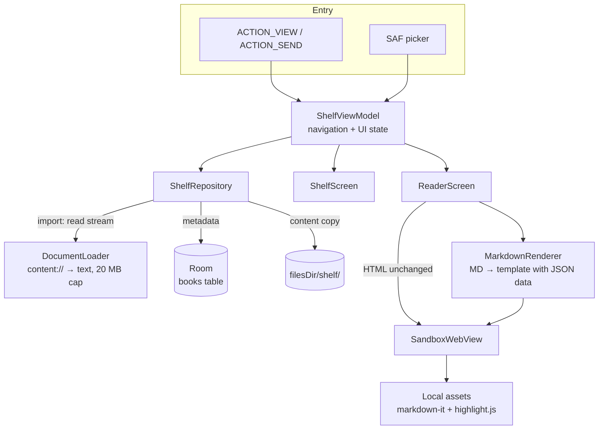

# YHViewer

**A lightweight, sandboxed Android reader for the HTML and Markdown files that AI tools generate.**


Screenshots use curated fictional documents and staged recency values. They are native emulator captures; see [capture notes](SCREENSHOTS.md).

| Shelf | HTML | Markdown | Sandbox test |
|---|---|---|---|
|  |  |  |  |

---

## Why

AI assistants increasingly answer with **HTML instead of Markdown**: sortable tables, collapsible sections, charts, small interactive tools. On a desktop you just open the file in a browser. On Android it's awkward:

- Mobile browsers handle local files poorly (`content://` URIs, no history, no library).
- A plain WebView wrapper does not isolate a generated page unless its permissions, settings, resource loading and navigation are deliberately restricted.

YHViewer treats every file as **untrusted content**. It opens it in a locked-down WebView and keeps it on a local shelf you can come back to.

## Features

- **Open from anywhere**: "Open with" from compatible file managers, "Share" from other apps, or the built-in picker.
- **Sandboxed rendering**: no network, no file system access, no JS bridge. External links only open on a real user tap (see [Security model](#security-model)).
- **Markdown support**: rendered by markdown-it with syntax highlighting, light/dark themes and an offline bundle. Raw HTML inside Markdown is escaped.
- **Shelf**: recent files, favorites and search. Files are copied on import, so they stay readable after the source is deleted or the app restarts.
- **Lightweight**: uses the system WebView, no bundled browser engine, and the APK declares **no `INTERNET` permission**.

## Security model

Defense in depth: complementary restrictions limit device access, resource loading and navigation. Each mechanism is checked against the behavior it is responsible for.

| # | Layer | Mechanism | Blocks |
|---|---|---|---|
| 1 | OS permission | No `INTERNET` permission in the manifest | Any network access from the app process |
| 2 | WebView settings | `allowFileAccess = false`, `allowContentAccess = false`, no `addJavascriptInterface`, no auto popups | Reading device files, calling into Kotlin |
| 3 | Request interception | `shouldInterceptRequest` serves only the virtual origin `appassets.androidplatform.net`; everything else gets an empty `403` | Loading external resources |
| 4 | Content-Security-Policy | Sent as a **response header**: `connect-src 'none'`, `frame-src 'none'`, `default-src 'none'` + allow-list | fetch/XHR/WebSocket, external scripts, images, iframes |

Two additional policies:

- **Navigation**: `shouldOverrideUrlLoading` only hands `http(s)`/`mailto` links to the system browser when `request.hasGesture()` is true. Script-driven redirects are dropped.
- **Storage isolation**: all documents share one virtual origin, so `localStorage` is wiped before each document loads. Otherwise document A could read what document B stored.


### Markdown injection

Markdown is never parsed in Kotlin. The raw text is embedded into a template as JSON inside `<script type="application/json">`, and markdown-it renders it inside the same sandbox. The encoder escapes **every `<` as `\u003c`**, so payloads like `</script><script>…` or `<!--` can't close the data block early. This is covered by JVM unit tests.

## Architecture



### Key design decisions

| Decision | Why | Trade-off |
|---|---|---|
| **Copy on import** | URIs from "Open with" carry temporary grants that expire when the app restarts. A private copy keeps the shelf readable, offline, without relying on the original URI grant. | The copy doesn't follow source edits; reopening the source refreshes it. |
| **Metadata in Room, content on disk** | Keeps the DB small and queries fast (same idea as storing blobs in object storage). | Two stores to keep consistent. Rows are deleted before files, so a failure leaves an orphan file rather than a broken row. |
| **Atomic writes** (`.tmp` → `rename`) | A crash mid-write never leaves a half-written copy. | — |
| **Unique `sourceUri` + transaction** | Reopening the same file updates the entry instead of duplicating it. | The same file opened through two different providers may still appear twice. |
| **Escaped `LIKE` search** | Searching `50%` or `a_b` matches literally. | — |
| **Render Markdown in the WebView** | One rendering path and one security boundary for both formats. | Needs bundled JS (~250 KB). |
| **Block CDNs by default** | Safe default for untrusted files. | AI pages that load chart libraries from a CDN won't render charts yet (see roadmap). |

## Testing

**15 JVM tests + 25 instrumented tests**, plus a self-checking sandbox page.

| Suite | Type | Count | Covers |
|---|---|---:|---|
| `MarkdownRendererTest` | JVM | 10 | JSON/script escaping, closing tags and comments, quotes, controls, Unicode and literal replacement |
| `EscapeLikeTest` | JVM | 4 | Literal LIKE wildcards and backslash ordering |
| `ExampleUnitTest` | JVM | 1 | Generated arithmetic smoke test |
| `ShelfDaoTest` | Instrumented | 7 | In-memory Room: sorting, case-insensitive search, literal `%`/`_`, favorites, timestamps and unique source URI |
| `ShelfRepositoryTest` | Instrumented | 7 | Temporary storage: import/open, source refresh, source deletion, timestamps, atomic files, removal and missing-copy error |
| `ShelfUiTest` | Instrumented | 2 | Shelf sorting/search/favorites, cancel/confirm deletion, Activity recreation without re-import, local-copy reading and layered back handling |
| `ReaderIntegrationTest` | Instrumented | 3 | `ACTION_VIEW` / `ACTION_SEND`, same Activity reuse, Markdown raw-HTML safety, fresh document history, real-link back navigation and the 20 MiB limit |
| `SandboxIntegrationTest` | Instrumented | 3 | Nine page checks and storage re-open, automatic vs user navigation, independent 403 callback checks and iframe CSP events |
| `MarkdownRenderingIntegrationTest` | Instrumented | 2 | Rendering structure, highlighting/colors, JSON round trip, script safety, remote-image CSP, wide-table scrolling, browser handoff and library/fallback build variants |
| `ExampleInstrumentedTest` | Instrumented | 1 | Generated application-context/package smoke test |

The **40 tests include the two generated smoke tests**. Re-running a case in dark mode, with a missing library, or with temporary network permission does not add another test to this count. Last full run: **15 JVM + 25 instrumented, zero failures or skips**, on an API 37 emulator.

The process-death check was also performed outside instrumentation: import a dedicated file, `am force-stop` the app, delete that original file, cold-start, then open the shelf copy. Database identity and copied bytes were checked before and after. See [MVP verification](STEP5_VERIFICATION.md).

### Sandbox verification

`sandbox-test.html` runs 9 checks in the page and exposes `window.__sandboxResult` for automated assertion: JavaScript execution, external image, fetch, `file://`, `content://`, WebSocket, external iframe, cross-document `localStorage`, and CSP enforcement.

> **Methodology:** the normal APK has no network permission, so a failed network request alone would not establish that the WebView sandbox blocked it. The same page was therefore run **with `INTERNET` temporarily granted**. A native HTTPS positive control returned **200**; opening and re-opening the sandbox page still produced **9/9 PASS**. The permission was then removed, the APK permission list checked, and the page re-tested.

The individual evidence is narrower than claiming every layer was disabled and tested in isolation:

- WebView settings are asserted on the live view.
- The real request-interception callback is exercised directly and returns **403** for external, file/content, missing-resource and lookalike-host requests, without relying on CSP to trigger the callback.
- CSP is checked through `securitypolicyviolation` events, including an independent `frame-src`/blocked-origin assertion. The page's aggregate iframe check alone could otherwise be satisfied by an earlier violation.
- Real taps launch a browser Intent; scripted redirects leave the document in place.

CSP-blocked requests may never reach the interceptor, so Logcat alone is insufficient evidence. The temporary permission run removes the OS-permission safety net; it does **not** by itself prove every other layer independently blocks every attack. See [sandbox verification](STEP3_VERIFICATION.md).


## Tech stack

Kotlin · Jetpack Compose (Material 3) · Android WebView + `androidx.webkit` (`WebViewAssetLoader`) · Room + KSP · Coroutines / Flow · markdown-it · highlight.js · JUnit4 / AndroidX Test

## Build

```bash
git clone https://github.com/Zer0Rin/yhviewer.git
cd yhviewer
./gradlew :app:assembleDebug
./gradlew :app:testDebugUnitTest
./gradlew :app:connectedDebugAndroidTest --no-configuration-cache
```

Open the project in Android Studio or configure your SDK path locally. The project pins **AGP 9.4.0**, **Gradle 9.6.0**, **compile/target SDK 37**, and a **JDK 25 daemon toolchain**; `minSdk` is **26**. The wrapper/toolchain may download dependencies during development. The installed app itself stays offline. Only the API 37 emulator has been verified so far.

The missing-library acceptance run temporarily renames `assets/md/markdown-it.min.js`, rebuilds, and runs `MarkdownRenderingIntegrationTest#libraryAvailabilityMatchesBuildVariant` with `missingMarkdown=true`. Restore the file and rebuild the normal APK afterwards. For the network-permission sandbox run, use `SandboxIntegrationTest` with `expectInternet=true` and a temporary debug Manifest permission, then remove it. See the step verification records for details.

## Project structure

```
app/src/main/
├── java/.../
│   ├── MainActivity.kt        # intent handling, AppRoot, ReaderScreen
│   ├── ShelfScreen.kt         # shelf UI
│   ├── ShelfViewModel.kt      # navigation + state
│   ├── ShelfRepository.kt     # import / open / delete, atomic writes
│   ├── Shelf.kt               # Room entity, DAO, database
│   ├── DocumentLoader.kt      # content:// → text, type detection
│   ├── SandboxWebView.kt      # the four-layer sandbox
│   └── MarkdownRenderer.kt    # safe MD → template injection
├── assets/md/                 # template.html, markdown-it, highlight.js, themes
└── AndroidManifest.xml        # no INTERNET permission
app/schemas/                   # exported Room schema (v1)
```

## Limitations & roadmap

- [ ] **Per-document "allow network" toggle** so CDN-based charts can render, opt-in per file
- [ ] **Reading themes** ("light touch" mode): font, size, width and accent, reusing the template's CSS variables
- [ ] **Folder access** (`OpenDocumentTree`) for HTML that references relative images and CSS
- [ ] Content-hash dedupe across providers; orphan-file cleanup on startup
- [ ] Optional KaTeX / Mermaid modules (kept out of the core to stay lightweight)
- [ ] Real-device matrix (OEM file managers and WebView versions)

## License

[MIT](LICENSE) — copyright 2026 Zer0Rin.

Third-party: [markdown-it](https://github.com/markdown-it/markdown-it) (MIT), [highlight.js](https://github.com/highlightjs/highlight.js) (BSD-3-Clause). License texts are bundled in the app. See [third-party notices](THIRD_PARTY_NOTICES.md).
