<p align="center"></p>

# YHViewer

**A lightweight, sandboxed Android reader for what AI tools produce (HTML, Markdown and code), plus TXT and EPUB books.**

[](https://github.com/Zer0Rin/yhviewer/actions/workflows/ci.yml)
[](https://github.com/Zer0Rin/yhviewer/releases/latest)


**v1.0.0** brings sandboxed HTML, Markdown, code, TXT and EPUB reading in Strict and Standard editions, continuous chapters, large-TXT indexing, import and shelf tools, live layout controls, and editing and script execution. See [release notes](docs/releases/v1.0.0.md) and [device acceptance](docs/verification/V1_DEVICE_ACCEPTANCE.md).

**v0.8.0** adds byte-indexed TXT opening, default continuous TXT/EPUB chapters, live reading layout controls and a draggable TOC fast scroller. Aa retains the single-chapter option. Large-TXT heading matching uses bounded line windows while preserving legacy chapter semantics. See [release notes](docs/releases/v0.8.0.md), [verification](docs/verification/V08_VERIFICATION.md) and [v0.8.0 downloads](https://github.com/Zer0Rin/yhviewer/releases/tag/v0.8.0).

**v0.7.0** adds multiple-file and folder import, in-page/full-book search, bookmarks, footnotes and SVG preview. It retains the vector eye-and-V launcher icon and unifies paper, ink and terminal themes across the shelf, reader and editor, with a three-column cover grid, dotted reading progress and floating action capsules. Shelf groups, multi-selection, content filters, author search, EPUB covers and a chapter drawer remain available. It includes Strict and Standard editions. Strict stays offline; Standard adds explicit per-document network grants and bundled Python.

Screenshots are native API 37 emulator captures of curated fictional documents. The sandbox capture shows a real 9/9 result; temporary-network-permission evidence is linked below.

| Shelf | HTML | Markdown | Code | EPUB | Sandbox test |
|---|---|---|---|---|---|
|  | 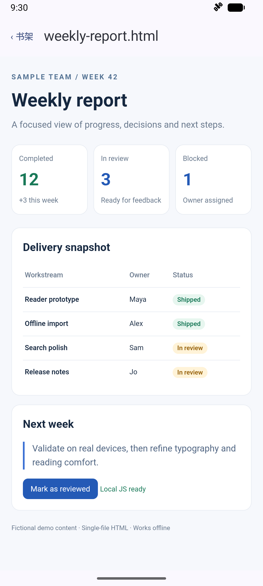 | 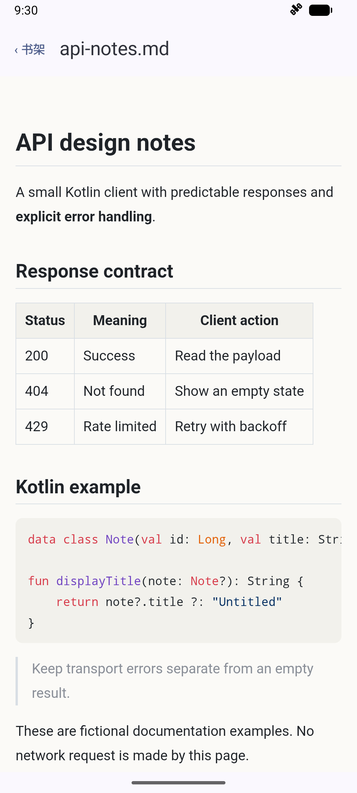 | 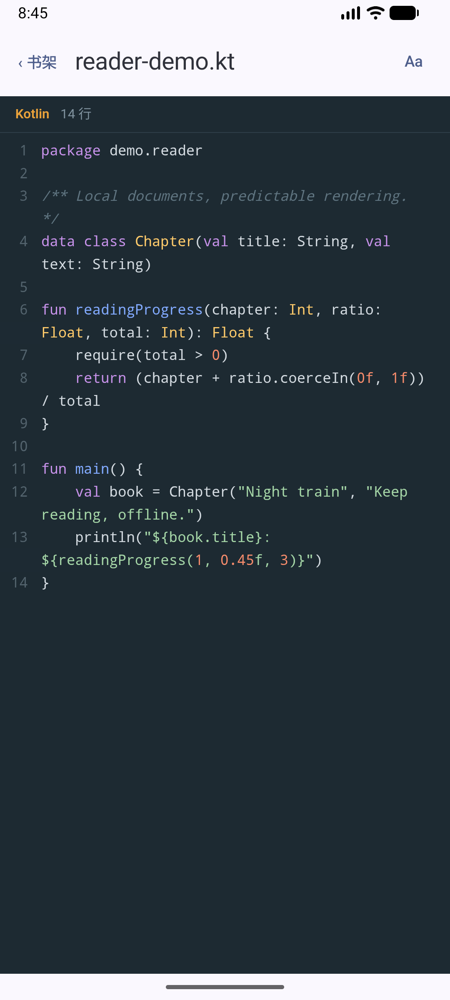 |  | 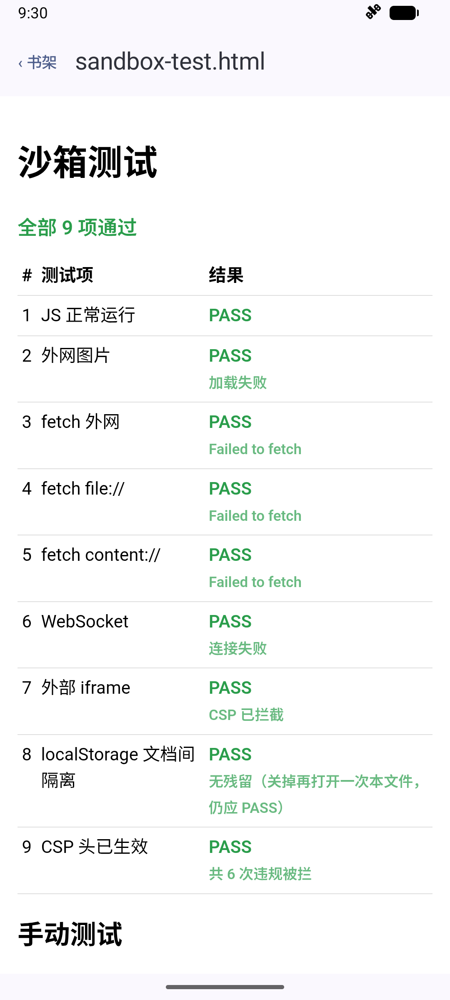 |

| Ink shelf | Multi-selection | Chapter drawer | Terminal reader | Paper Markdown |
|---|---|---|---|---|
| 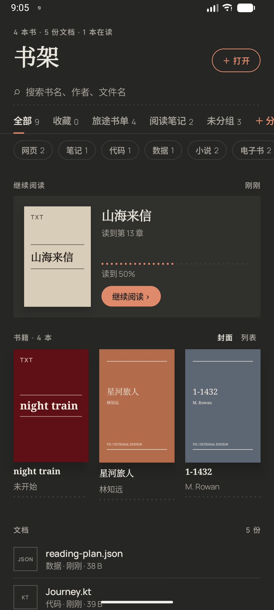 | 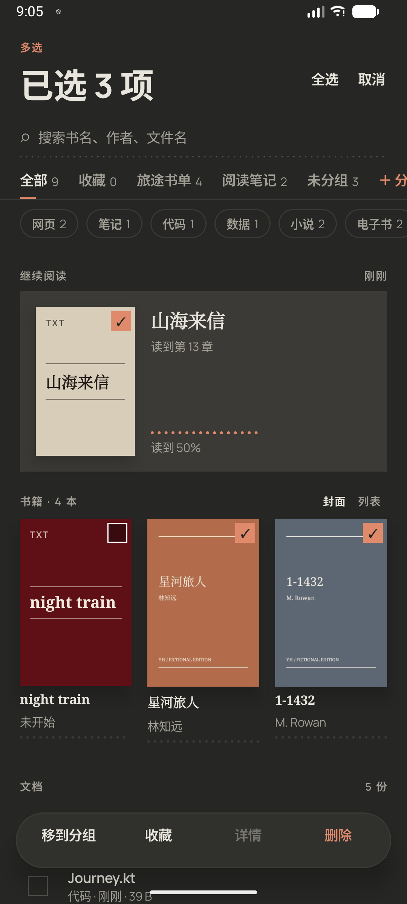 | 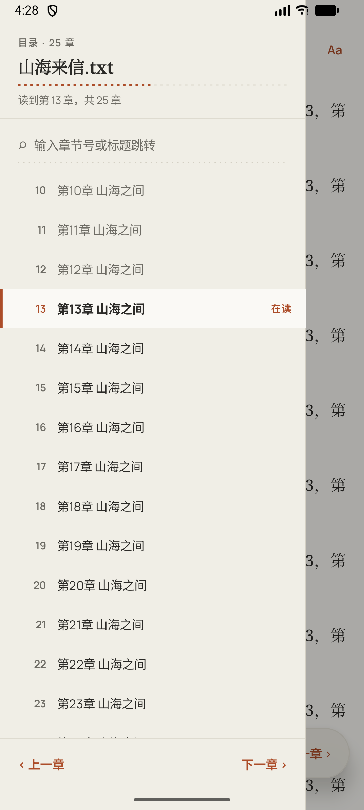 | 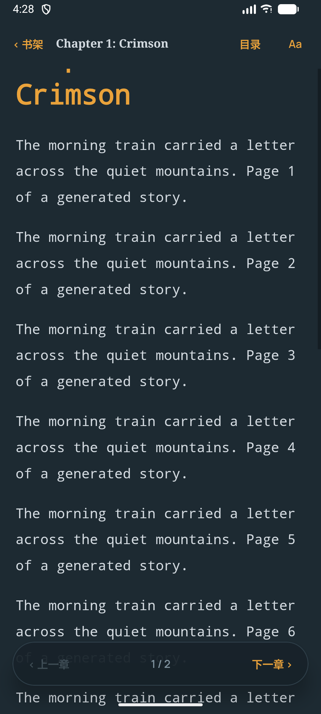 | 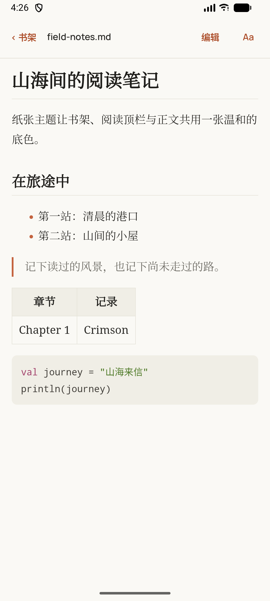 |

| Folder import report | Whole-book search |
|---|---|
| 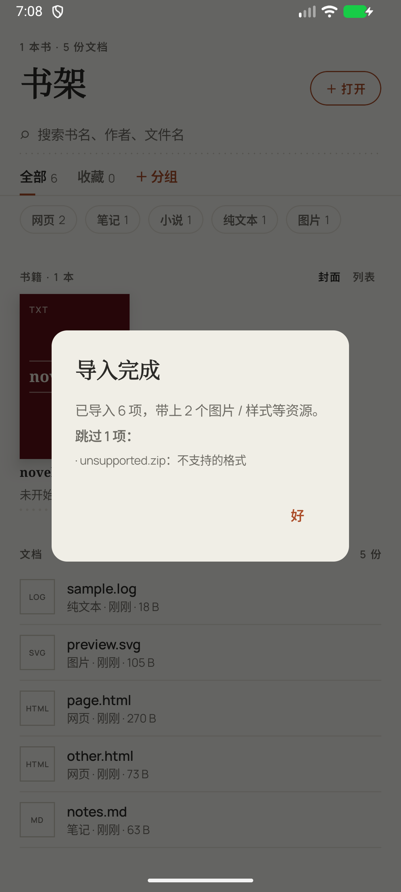 | 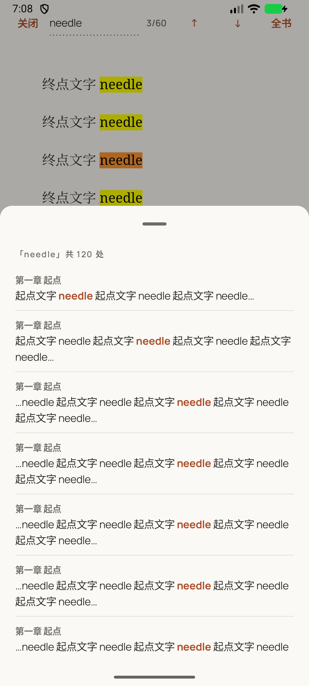 |

| Continuous boundary | Filtered TOC while dragging |
|---|---|
| 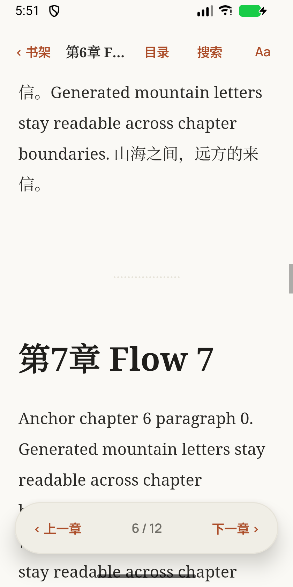 | 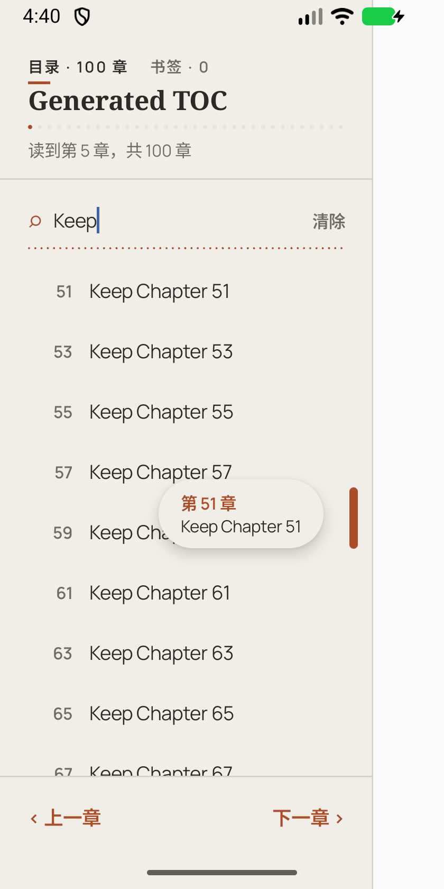 |

**[Download v1.0.0 APKs](https://github.com/Zer0Rin/yhviewer/releases/tag/v1.0.0)**: the tag-triggered workflow builds signed Strict and Standard R8 APKs, checks their final permissions and smoke-tests startup before publishing. See [v0.7 verification](docs/verification/V07_VERIFICATION.md), [v0.5 verification](docs/verification/V05_VERIFICATION.md), [RELEASE.md](RELEASE.md), [release preparation](docs/verification/RELEASE_PREPARATION.md) and [API 35 device acceptance](docs/verification/RELEASE_DEVICE_ACCEPTANCE.md).

---

## Why

AI assistants increasingly answer with **HTML instead of Markdown**: sortable tables, collapsible sections, charts, small interactive tools. Around those pages they also produce code, configs, logs and long Markdown notes. On a desktop you open them in a browser or an editor. On Android it's awkward:

- Mobile browsers handle local files poorly (`content://` URIs, no history, no library).
- A plain WebView wrapper needs deliberate restrictions on permissions, settings, resource loading and navigation to isolate untrusted pages.

YHViewer treats every file as **untrusted content**, renders it in a locked-down WebView, and keeps it on an offline shelf. Since the same sandbox and shelf work for long-form reading, it also reads TXT and EPUB books.

## Features

| Type | What you get |
|---|---|
| **HTML** | Rendered as-is in the sandbox. Per-document permissions; external links require a real tap by default |
| **Markdown** | markdown-it + highlight.js, bundled offline. Raw HTML inside Markdown is shown as text |
| **JavaScript execution** | Explicit Run button, isolated Worker console, 5-second timeout (optionally 30), stop/restart and bounded output; no network, DOM or device-file access |
| **Python execution (Standard)** | Bundled offline Pyodide / CPython standard library, separate startup and execution deadlines, Unicode output and user-code error lines; no external network or package downloads |
| **Code editing** | Offline CodeMirror 6 for code, plain text, Markdown and HTML up to 1,000,000 characters; syntax highlighting, search, undo/redo and a keyboard symbol bar. Run unsaved JS or Python snapshots |
| **Code** | File-type detection, line numbers excluded from copied text, wrap toggle and bundled syntax highlighting. Compact JSON up to 500,000 characters is formatted; large files skip highlighting and render in 200-line chunks |
| **TXT** | Encoding auto-detected (UTF-8 / GBK / Big5), chapters split by headings like `第X章` / `Chapter N`, table of contents; v0.8 adds a persistent byte index and lazy chapter reads |
| **EPUB** | EPUB 2 and 3, title and TOC from nav / NCX, images and publisher CSS, book scripts never run |

Reading and library features:

- **Multiple-file and folder import**: select several files or share them together. Folder import keeps HTML/Markdown with relative images, styles and other resources, reports unsupported/failed entries, and preserves existing metadata on reimport. A single HTML missing sibling resources explains how to import its folder.
- **Search**: native in-page find with previous/next matches; TXT and EPUB also search across chapters and jump to a specific match (up to 500 results). SVG text can be searched in its source view.
- **Bookmarks**: save and revisit chapter/scroll positions, remove bookmarks, and retain them across reading sessions. Nearby positions in the same chapter are deduplicated; deleting a document removes its bookmarks.
- **Additional formats**: Markdown footnotes, SVG image/source switching, and LOG classification as plain text. Detected vertical EPUBs are normalized to horizontal reading with an explanatory notice.
- **HTML dialogs**: alert/confirm/prompt use document-attributed native dialogs; repeated prompts may be blocked for the current page.

- **Reading themes**: Paper (light), Ink (dark), Terminal (monospace) and Auto (follows the system). Markdown, code and TXT switch in place. The v0.8 continuous EPUB reader updates its existing view; the single-chapter reader reloads with book scripts disabled. Position is preserved approximately and code colors follow the theme. HTML retains its original appearance and has no theme menu.
- **Book reading controls**: TXT and EPUB support immersive reading, confirmed left/right taps to move 90% of the viewport, chapter navigation, font size, line height, margins, font selection and keep-awake. Settings persist; EPUB scripts remain disabled.
- **Reading position**: saved per document as chapter + scroll ratio, restored after theme changes, rotation and app restarts. Saves are debounced and flushed on backgrounding; an abrupt kill can lose the most recent unsaved movement. The shelf shows how far you've read.
- **Save and Save as**: Save atomically updates only the private shelf copy; the source file is untouched. Reopening the original replaces that copy, so use Save as to retain edits in a new file. Save as also imports the new file into the shelf.
- **Shelf**: recent files, favorites, search. Files are copied on import, so they stay readable offline after the source is deleted.
- **Open from anywhere**: "Open with" from a file manager, "Share" from another app, or the built-in picker.

| Book reading controls | Document permissions (Standard) |
|---|---|
| 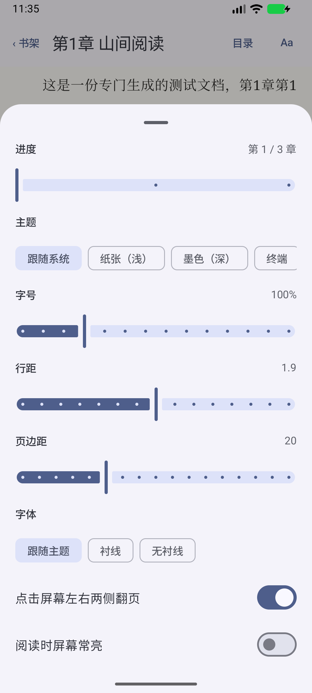 | 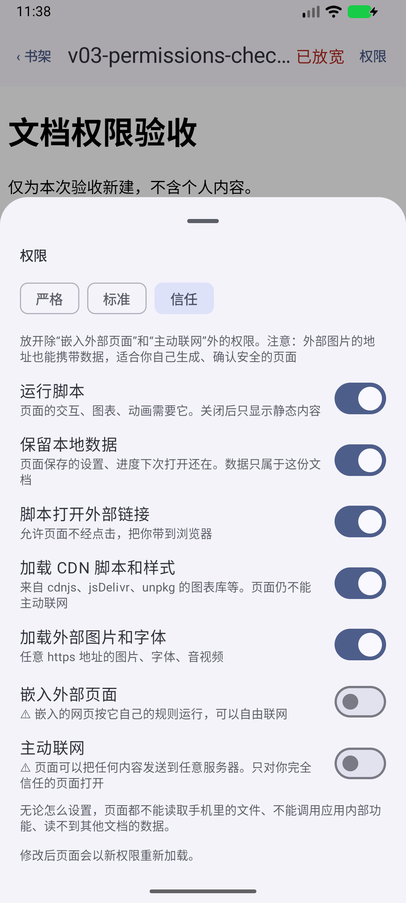 |

| Editor | Run console | Document permissions (Standard) |
|---|---|---|
| 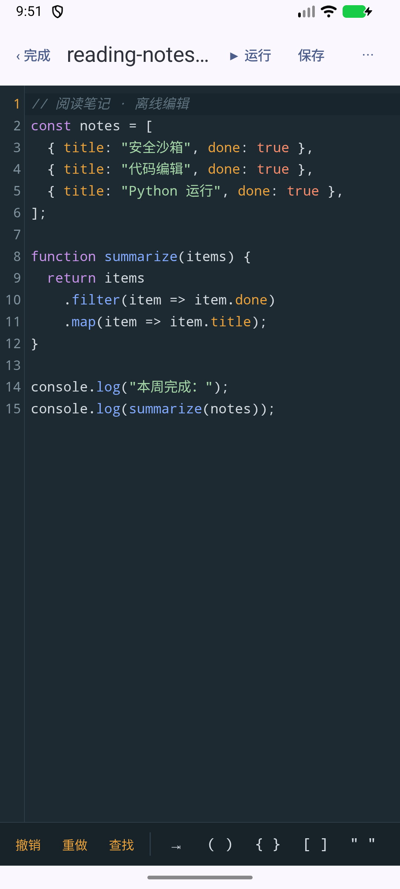 | 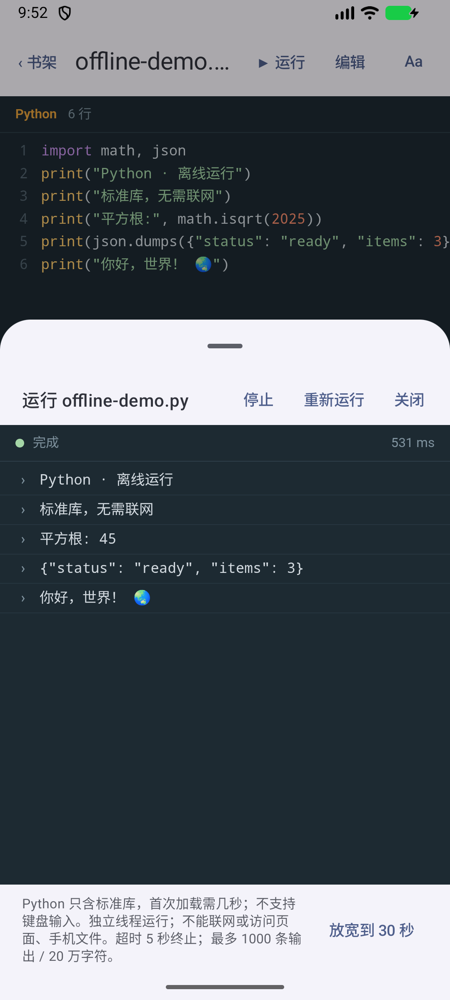 |  |

## Security model

Defense in depth: complementary restrictions limit device access, resource loading and navigation. Each mechanism is checked against the behavior it is responsible for.

| # | Layer | Mechanism | Blocks |
|---|---|---|---|
| 1 | OS permission | **Strict** has no `INTERNET`; **Standard** has it but blocks requests by default. CI and releases inspect both final APKs | Accidental flavor misconfiguration |
| 2 | WebView settings | No `file://` / `content://` access, no JS bridge, no auto popups, no cookies. Book scripts are disabled; the continuous reader uses a trusted layout shell | Reading device files, calling into Kotlin |
| 3 | Request interception | Current private origin and explicitly permitted HTTPS hosts only; unknown private paths return 403 | Unapproved resource hosts |
| 4 | Content-Security-Policy | Response header on local documents; permissions select resource types. Default `connect-src 'none'`, `frame-src 'none'`; EPUB `script-src 'none'` | Unapproved scripts, connections and frames in the current document |

HTML permissions are stored per document. Markdown, code and TXT always use the default sandbox; EPUB never runs scripts.

| Preset | Scripts | Persistent data | Scripted external links | CDN | External media | Iframes | fetch / XHR / WebSocket |
|---|---|---|---|---|---|---|---|
| Strict | | | | | | | |
| Standard (default) | ✓ | | | | | | |
| Trusted | ✓ | ✓ | ✓ | ✓ | ✓ | | |

Iframes and active networking require explicit manual grants and show warnings. Strict edition disables all four network-related switches. These are presets, not stored tier names: old combinations that include iframe access appear as Custom.

Inline scripts and `eval` are deliberately allowed by the default Standard document preset: an imported HTML file is treated as untrusted code, and its interaction is intentional. Here CSP constrains network/resource capabilities rather than attempting to prevent all script execution or XSS. The Strict preset disables scripts.

**Known boundaries:** third-party iframe documents do not inherit the parent document's CSP and may connect freely when iframe access is granted. Image, media and iframe URLs can carry document data to an external server. Disabling fetch/XHR/WebSocket does not promise that no data can leave a document after external resources or scripted external links are allowed. Only Strict's missing OS network permission prevents app networking entirely; handing a link to a browser is a separate user-visible action.

Plus:

- **Navigation**: real taps open the system browser; HTML may explicitly allow scripted external links. Approved HTTPS child-frame navigation stays in the frame.
- **Storage isolation**: each render gets an independent ephemeral WebView Profile; opt-in persistent data uses a document-specific generation. Revoking storage invalidates the generation immediately, even if an old WebView delays deletion. Startup/disposal retry cleanup. Older engines disable persistence and iframe access, and use an unguessable per-render virtual origin. Third-party iframe origins cannot be isolated on those engines. Cookies and service-worker networking stay disabled.
- **Injection-safe templates**: user content is embedded as JSON with every `<` encoded as `\u003c`, so `</script>` or `<!--` can't break out. The theme id is substituted **before** user content, so text that happens to contain the placeholder is never rewritten.

### EPUB is an untrusted zip full of untrusted HTML

| Threat | Defense |
|---|---|
| **Zip Slip** (`../../shared_prefs/x.xml`) | Entry names are checked (no `..`, absolute paths, backslashes, NUL), then the canonical path is verified to stay inside the target directory. Android 14+ has a similar platform check; this makes older versions behave the same |
| **Zip bomb** | Limits on entry count, per-file size and total size, counted from **bytes actually written**, never from sizes declared in the zip header |
| **XXE** | Entity declarations in metadata, TOCs and spine chapters are rejected; external entity resolution is disabled |
| **Scripts in chapters** | JavaScript disabled + `script-src 'none'` |
| **Broken books** | Archive bounds, metadata, spine files and entity declarations are checked before import commits. Failed or cancelled imports clean staging files and preserve any existing copy |

Chapter files are served through `WebViewAssetLoader.InternalStoragePathHandler`, which adds its own traversal checks. The reader injects theme styles into each chapter while serving it, without modifying the files on disk.

## JavaScript execution

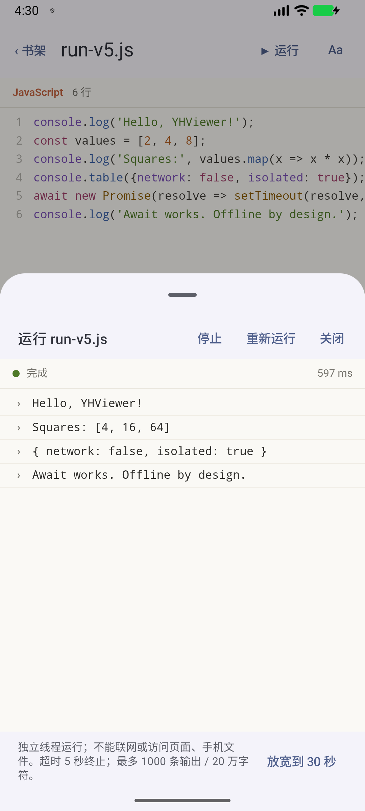

JavaScript code stays inert in the reader. **Run** opens a separate, ephemeral WebView and executes a source snapshot in a Web Worker. The runner always uses a fixed CSP and the Standard preset, regardless of the document’s grants or app edition. It exposes no native bridge, disables network connections and external script imports, and retains no storage between runs.

The parent terminates the Worker after 5 seconds (optionally 30), at 1,000 output entries or 200,000 characters. Clearing the console does not reset these budgets. Stop, restart, document replacement and closing the panel dispose the execution view. Renderer failure shows an error and permits a fresh run.

This is browser JavaScript: no Node.js APIs, TypeScript/JSX transpilation or module imports. Awaited work runs within the time limit; after top-level work finishes, the runner ends following a short quiet period, so it does not wait indefinitely for unawaited timers. A Worker shares the WebView renderer’s memory limit; a memory bomb can terminate that renderer, which the app handles without terminating its own process.

## Python execution and editing

Standard bundles Pyodide 0.26.4 / CPython 3.12.1 locally; Strict has no Python runtime
or Python Run action. Python runs in a fresh Worker with an in-memory filesystem,
only the bundled standard library and no package installation. Runtime startup has
its own 60-second deadline; the 5- or 30-second execution deadline starts after a
private readiness handshake. Output uses the same bounds as JavaScript. `input()`
returns EOF with an explanation. Python can read only its bundled runtime assets;
external requests and native files are blocked. An up-to-date WebView with
WebAssembly support is needed (Pyodide 0.26 targets Chromium 112 or later).

The trusted editor uses its own fixed CSP and never inherits an HTML document's
permissions. Native code pulls text through `evaluateJavascript`; the page has no
native bridge. Missing or failed editor assets refuse saving instead of returning
empty content. The in-memory editor session preserves unsaved content across
rotation and other Activity configuration changes; Save is needed to survive
process death or renderer failure. Incoming file opens require a save/discard/cancel
decision before replacing the editor. A save records the exact written snapshot, so newer keystrokes stay
unsaved. A Worker can still exhaust renderer memory; renderer recovery applies to
Python and the editor as well as JavaScript.

See [editor build](tools/editor/README.md) and [runtime provenance and checksums](tools/pyodide/README.md)
for reproducible bundled assets and licenses.

## Architecture


### Key design decisions

| Decision | Why | Trade-off |
|---|---|---|
| **Copy on import** | "Open with" URIs carry temporary grants that expire after a restart. A private copy keeps the shelf readable offline | The copy doesn't follow source edits; reopening the source refreshes it |
| **Re-import as an atomic swap** | Write the new copy under a fresh name, update the row in a transaction, then delete the old copy. A crash at any step never leaves a row pointing to a half-written file | Briefly uses twice the space |
| **Detect encoding once** | TXT is decoded at import (BOM → strict UTF-8 → GB18030 / Big5 / UTF-16 scoring) and stored as UTF-8, so opening never guesses again | Big5 text can occasionally be misread as GB18030 |
| **Position = chapter + ratio** | Pixel offsets break when the theme, font or orientation changes; a ratio survives all three | Approximate within very long chapters |
| **Debounced saves + flush on stop** | Scrolling writes nothing until it settles for 0.8 s; leaving the reader or backgrounding the app saves immediately | — |
| **One chapter per page** | A multi-MB novel in a single DOM is slow; chapters keep pages small. Code files use `content-visibility` chunks to reduce layout/paint work; all line nodes still exist | — |
| **Orphan cleanup on startup** | Removes copies no row points to and interrupted imports; imports wait for it to finish so a fresh copy is never deleted | — |
| **Block CDNs by default** | Safe default for untrusted files | Standard edition can explicitly permit the supported CDNs per HTML file |

## Testing

Follow the [testing plan](docs/testing/TEST-PLAN.md) for change-based checks, required pre-merge L2 instrumentation and the release-only L3 device checklist. It supersedes the one-time 1.0 `DEVICE-TEST-PLAN.md`.

The suite includes JVM policy/template tests and native database, navigation, reading and WebView integration tests. Both editions run in CI. CI runs the device suite on **API 34**; local acceptance uses **API 37**. The v0.2.0 officially signed R8 build was also smoke-tested on a physical **API 35** device. Editor/lifecycle, native CJK input and real Python checks also passed on API 35 using a separate QA app and generated documents. The user then upgraded the official app with the signed Standard candidate and confirmed all eight existing shelf records and reading progress were retained. Reports and debug APKs are retained as CI artifacts for 14 days.

| Area | Type | Covers |
|---|---|---|
| Template safety | JVM | `</script>` / `<!--` breakout, placeholder ordering, theme whitelist |
| EPUB | JVM | Zip Slip variants, zip bomb and entry limits, XXE rejection, OPF / nav / NCX parsing, href resolution, theme injection |
| Text | JVM | Encoding detection (UTF-8, BOM, GBK, UTF-16), chapter splitting (TOC at start, long lines, fallback by size), file-type detection |
| Data | Instrumented (in-memory Room) | Ordering, search with literal `%` / `_`, favorites, unique source |
| Repository | Instrumented (temp dirs, injected clock) | Import and reopen for every type, atomic re-import, GBK → UTF-8, position round trip, malicious EPUB leaves no files, orphan cleanup |
| Migration | Instrumented (`MigrationTestHelper`) | v1 → v2 → v3 → v4 keeps existing rows, progress and permissions; adds author/cover/classification defaults and groups, schema validated against the exported JSON |
| Permissions | JVM + instrumented | All 128 bit combinations, presets excluding iframe/network, build capabilities, independent storage, live-profile revocation, real CSP parent/iframe boundary |
| Reading settings | JVM + instrumented | Finite normalization, safe CSS, confirmed taps, stable viewport, previous chapter end and persisted controls |
| JS execution | JVM + instrumented | Safe source embedding, syntax/runtime line mapping, real Worker CSP, Unicode line separators, timeout, console flood/forged messages, fresh storage, live themes, stop/restart/close and renderer loss |
| Editing | JVM + instrumented | JSON string decoding, injection-safe editor payloads, real CodeMirror, exact snapshot saves, source preservation, missing components, atomic edits and save-as |
| Python | JVM + instrumented | Real bundled WASM and standard library, top-level await, user-code tracebacks, EOF, network blocking, startup/run budgets and forged-message limits |
| Renderer recovery | Instrumented | Controlled renderer crash keeps the app alive, safe reopening, strict EPUB policy, UTF-16 response and profile thread guards |
| App flows | Instrumented | Open-with, share, single-instance reuse, back-stack layering, size limits |

### Sandbox verification

`sandbox-test.html` runs 9 checks in the page and exposes `window.__sandboxResult` for automated assertion: JavaScript execution, external image, fetch, `file://`, `content://`, WebSocket, external iframe, cross-document `localStorage`, and CSP enforcement.

> **Methodology (historical v0.2.0 acceptance):** the original APK has no network permission, so a failed network request alone would not establish that the WebView sandbox blocked it. The same page was therefore run **with `INTERNET` temporarily granted**. A native HTTPS positive control returned **200**; opening and re-opening the sandbox page still produced **9/9 PASS**. The permission was then removed, the APK permission list checked, and the page re-tested.

The individual evidence is narrower than claiming every layer was disabled and tested in isolation:

- WebView settings are asserted on the live view.
- The real request-interception callback is exercised directly and returns **403** for external, file/content, missing-resource and lookalike-host requests, without relying on CSP to trigger the callback.
- CSP is checked through `securitypolicyviolation` events, including an independent `frame-src`/blocked-origin assertion. The page's aggregate iframe check alone could otherwise be satisfied by an earlier violation.
- Real taps launch a browser Intent; scripted redirects leave the document in place.

CSP-blocked requests may never reach the interceptor, so Logcat alone is insufficient evidence. The temporary permission run removes the OS-permission safety net; it does **not** by itself prove every other layer independently blocks every attack. See [sandbox verification](docs/verification/STEP3_VERIFICATION.md).

Standard edition now provides the permanent network-permission test round; it checks a native HTTPS positive control and the default 9/9 sandbox result. Relaxed permissions intentionally change those expected outcomes. See [v0.3 integration verification](docs/verification/V03_VERIFICATION.md).

See [v0.4.0 integration verification](docs/verification/V04_VERIFICATION.md), [editor and Python acceptance](docs/verification/EDITOR_PYTHON.md), [JS runner verification](docs/verification/JS_RUNNER.md), [renderer recovery](docs/verification/RENDERER_RECOVERY.md), and [v2 verification](docs/verification/V2_VERIFICATION.md) for the complete suite inventory, local/CI results and upgrade evidence.

## Tech stack

Kotlin · Jetpack Compose (Material 3) · Android WebView + `androidx.webkit` · Room + KSP · Coroutines / Flow · markdown-it · highlight.js · CodeMirror 6 · Pyodide (Standard) · JUnit4 / AndroidX Test · GitHub Actions

## Build

```bash
git clone https://github.com/Zer0Rin/yhviewer.git
cd yhviewer
./gradlew assembleStrictDebug assembleStandardDebug  # build both editions
./gradlew testStrictDebugUnitTest testStandardDebugUnitTest
./gradlew :app:connectedStrictDebugAndroidTest :app:connectedStandardDebugAndroidTest --no-configuration-cache  # emulator or device
```

`minSdk 26`, compile/target SDK 37 (`platforms;android-37.0`), AGP 9.4.0, Gradle 9.6.0 and a JDK 25 daemon toolchain. Configure the local SDK path or open in Android Studio. Release signing reads environment variables only; see [RELEASE.md](RELEASE.md). The application ID is `io.github.zer0rin.yhviewer`; the old `com.example.yhviewer` development build remains a separate app with its own shelf.

## Limitations & roadmap

Text imports are capped at 20 MiB (HTML/Markdown/code), TXT at 32 MiB and compressed EPUB at 100 MiB. Extracted EPUB limits are 3,000 entries, 50 MiB per entry and 200 MiB total; XML/chapter input is capped at 10 MiB each. EPUB XML/XHTML is decoded before validation and rendering, including BOM-marked UTF-16. DRM and publisher interactive features are unsupported. Big5 detection is heuristic, and scroll ratios preserve an approximate location rather than an exact paragraph.


- [x] Offline CodeMirror editing and snapshot execution
- [x] Standard-only offline Python execution
- [x] Explicit JavaScript execution sandbox
- [x] Per-document permissions and Strict / Standard editions
- [x] **Folder access** (`OpenDocumentTree`) for importing HTML with relative images and CSS
- [ ] Statistical charset detection (e.g. ICU) to tell Big5 from GB18030 reliably
- [ ] Optional KaTeX / Mermaid modules (kept out of the core to stay lightweight)
- [x] Font size, line height, margins and immersive controls for books
- [ ] Real-device matrix (OEM file managers and WebView versions)

## License

MIT, see [LICENSE](LICENSE). Third-party: [markdown-it](https://github.com/markdown-it/markdown-it) (MIT), [highlight.js](https://github.com/highlightjs/highlight.js) (BSD-3-Clause), plus CodeMirror (MIT), Pyodide (MPL-2.0) and CPython (PSF); see [third-party notices](THIRD_PARTY_NOTICES.md).
