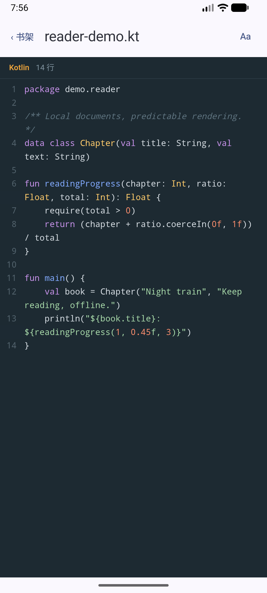
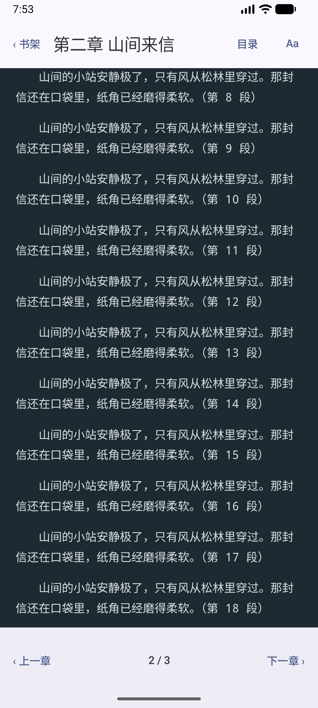
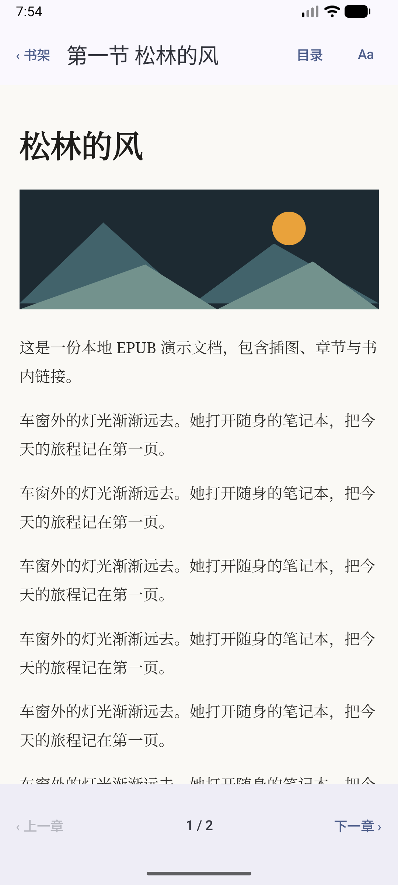
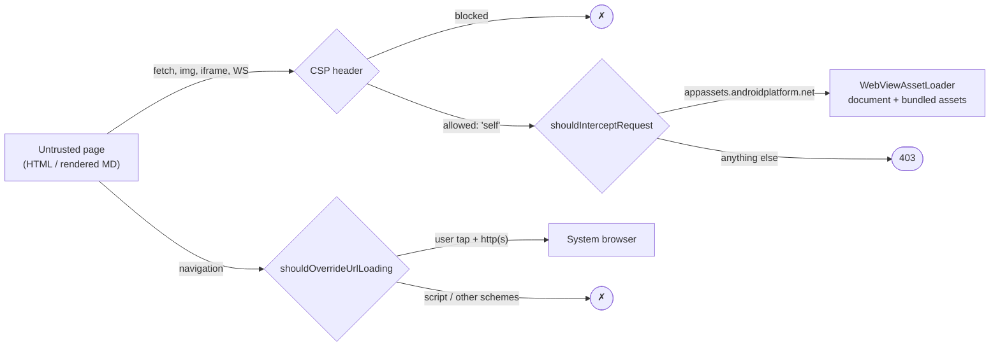
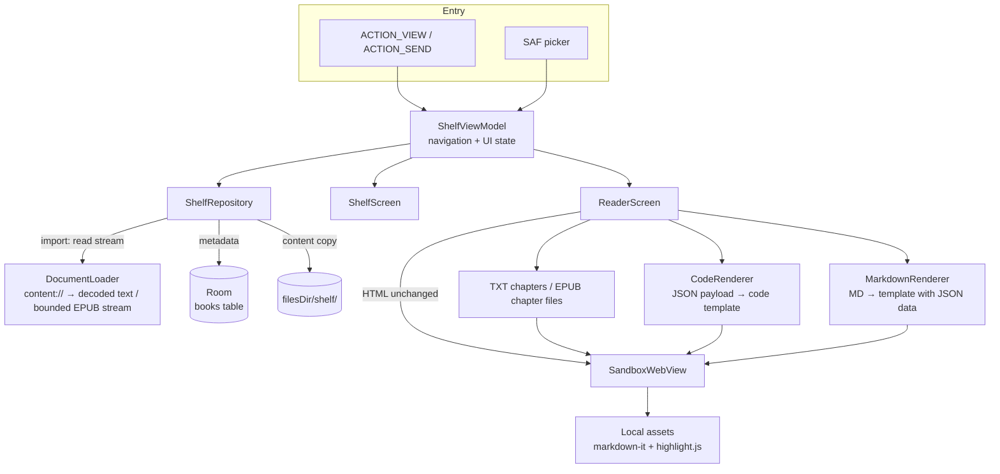

# YHViewer

**A lightweight, sandboxed Android reader for HTML, Markdown, source code, TXT novels and EPUB books.**


[](https://github.com/Zer0Rin/yhviewer/actions/workflows/ci.yml)

Screenshots use curated fictional documents and staged recency values. They are native API 37 emulator captures (1080×2400). The sandbox screenshot shows a real 9/9 result from the normal APK without network permission; the temporary-permission run is documented in the verification logs below.

| Shelf | HTML | Markdown | Sandbox test |
|---|---|---|---|
|  |  |  |  |

---

## Why

AI assistants increasingly answer with **HTML instead of Markdown**: sortable tables, collapsible sections, charts, small interactive tools. On a desktop you just open the file in a browser. On Android it's awkward:

- Mobile browsers handle local files poorly (`content://` URIs, no history, no library).
- A plain WebView wrapper does not isolate a generated page unless its permissions, settings, resource loading and navigation are deliberately restricted.

YHViewer treats every file as **untrusted content**. It opens it in a locked-down WebView and keeps it on a local shelf you can come back to.

## Features

- **Open from anywhere**: "Open with" from compatible file managers, "Share" from other apps, or the built-in picker.
- **Sandboxed rendering**: no network, no file system access, no JS bridge. External links only open on a real user tap (see [Security model](#security-model)).
- **Markdown support**: offline markdown-it rendering with highlight.js syntax highlighting. Raw HTML inside Markdown is escaped.
- **Reading themes**: Paper (light), Ink (dark), Terminal (monospace) and Auto (follows the system). Markdown, code and TXT update in place; EPUB reloads with scripts disabled. Reading position and highlight colors follow the theme.
- **Code reading**: line numbers excluded from copied text, syntax highlighting where bundled languages are available, a saved wrap toggle, and automatic formatting for compact JSON up to 500,000 characters. Large files skip highlighting and use 200-line `content-visibility` chunks.
- **TXT novels**: encoding detection (BOM / UTF-8 / GB18030 / Big5), UTF-8 private copies, chapter detection and a table of contents. Text without chapter headings splits into roughly 8,000-character sections.
- **EPUB books**: title and chapter navigation, embedded images and styles, internal chapter links, and reading themes. Import validates the archive before adding it to the shelf; chapter JavaScript stays disabled.
- **Reading progress**: chapter plus scroll ratio, saved after scrolling stops and on backgrounding, restored when reopening. The shelf shows overall percentage.
- **Shelf**: recent files, favorites and search. Files are copied on import, so they stay readable after the source is deleted or the app restarts.
- **Lightweight**: uses the system WebView, no bundled browser engine, and the APK declares **no `INTERNET` permission**.

| Code · Terminal | TXT · restored chapter | EPUB · Paper |
|---|---|---|
|  |  |  |

Native API 37 captures of generated fictional documents. The TXT capture follows a real force-stop/cold-start after deleting its original file.

## Reading themes

Markdown, code, TXT and EPUB documents have an **Aa** menu: Paper (light), Ink (dark), Terminal, or Follow system. The choice is saved locally. Markdown, code and TXT switch without reloading; EPUB recreates the chapter with injected CSS so JavaScript can remain disabled. Position is preserved as a scroll ratio, and code highlighting uses the same theme variables. HTML documents retain their original appearance and do not show this menu.

| Paper | Ink | Terminal |
|---|---|---|
|  |  |  |

Native API 37 captures of the same test document, with the system in light mode. The app bar still follows the system theme.

## Security model

Defense in depth: complementary restrictions limit device access, resource loading and navigation. Each mechanism is checked against the behavior it is responsible for.

| # | Layer | Mechanism | Blocks |
|---|---|---|---|
| 1 | OS permission | No `INTERNET` permission in the manifest | Any network access from the app process |
| 2 | WebView settings | `allowFileAccess = false`, `allowContentAccess = false`, no `addJavascriptInterface`, no auto popups | Reading device files, calling into Kotlin |
| 3 | Request interception | `shouldInterceptRequest` serves only the virtual origin `appassets.androidplatform.net`; everything else gets an empty `403` | Loading external resources |
| 4 | Content-Security-Policy | Sent as a **response header**: `connect-src 'none'`, `frame-src 'none'`, `default-src 'none'` + allow-list | fetch/XHR/WebSocket, external scripts, images, iframes |

EPUB chapters additionally have JavaScript and DOM storage disabled, with `script-src 'none'`. Only their private extracted directory is served under `/book/`; publisher CSS colors are overridden by the selected reading theme.

EPUB import checks entry names and canonical destinations, counts actual decompressed bytes, rejects XML entity declarations in metadata/TOCs/chapters, and checks spine chapter files. XML and chapter input is capped at 10 MiB each. Limits are 3,000 entries, 50 MiB per entry and 200 MiB total extracted size. Failed or cancelled imports preserve the old copy and clean new staging files. Startup orphan cleanup and imports share a lock across repository instances.

Two additional policies:

- **Navigation**: `shouldOverrideUrlLoading` only hands `http(s)`/`mailto` links to the system browser when `request.hasGesture()` is true. Script-driven redirects are dropped.
- **Storage isolation**: all documents share one virtual origin, so `localStorage` is wiped before each document loads. Otherwise document A could read what document B stored.



### Markdown injection

Markdown is never parsed in Kotlin. The raw text is embedded into a template as JSON inside `<script type="application/json">`, and markdown-it renders it inside the same sandbox. The encoder escapes **every `<` as `\u003c`**, so payloads like `</script><script>…` or `<!--` can't close the data block early. This is covered by JVM unit tests.

## Architecture



### Key design decisions

| Decision | Why | Trade-off |
|---|---|---|
| **Copy on import** | URIs from "Open with" carry temporary grants that expire when the app restarts. A private copy keeps the shelf readable, offline, without relying on the original URI grant. | The copy doesn't follow source edits; reopening the source refreshes it. |
| **Metadata in Room, content on disk** | Keeps the DB small and queries fast (same idea as storing blobs in object storage). | Two stores to keep consistent. Rows are deleted before files, so a failure leaves an orphan file rather than a broken row. |
| **Atomic writes** (`.tmp` → `rename`) | A crash mid-write never leaves a half-written copy. | — |
| **Unique `sourceUri` + transaction** | Reopening the same file updates the entry instead of duplicating it. | The same file opened through two different providers may still appear twice. |
| **Escaped `LIKE` search** | Searching `50%` or `a_b` matches literally. | — |
| **Render Markdown in the WebView** | One rendering path and one security boundary for both formats. | Needs bundled JS (~250 KB). |
| **Chapter + scroll ratio** | Keeps an approximate reading position through layout changes; writes are debounced and flushed on backgrounding. | A ratio is not a semantic paragraph anchor; changes to content or layout can shift the exact text. |
| **Room v1 → v2 migration** | Preserves shelf metadata while adding nullable locator and default-zero progress. Exported schemas and a migration test check the result. | — |
| **Block CDNs by default** | Safe default for untrusted files. | AI pages that load chart libraries from a CDN won't render charts yet (see roadmap). |

## Testing

**76 JVM tests + 43 instrumented tests**, plus a self-checking sandbox page.

GitHub Actions runs JVM tests, lint and a debug build on pushes and pull requests. Pushes to `main` and manual runs also run the instrumented suite on an API 34 emulator. Test reports and the debug APK are available as workflow artifacts (14-day retention). The temporary-network-permission sandbox round remains a separate acceptance check.

Step-by-step verification logs: [docs/verification/](docs/verification/), including the [first CI results](docs/verification/CI_VERIFICATION.md).

| Suite | Type | Count | Covers |
|---|---|---:|---|
| `MarkdownRendererTest` | JVM | 10 | JSON/script escaping, closing tags and comments, quotes, controls, Unicode and literal replacement |
| `ReaderThemeTest` | JVM | 6 | Theme IDs/fallback, initial theme, default auto and placeholder text preserved in Markdown |
| `EscapeLikeTest` | JVM | 4 | Literal LIKE wildcards and backslash ordering |
| `ExampleUnitTest` | JVM | 1 | Generated arithmetic smoke test |
| `ShelfDaoTest` | Instrumented | 7 | In-memory Room: sorting, case-insensitive search, literal `%`/`_`, favorites, timestamps and unique source URI |
| `CodeLanguagesTest`, `CharsetDetectorTest`, `TxtChaptersTest`, `TxtLongLineTest`, `LocatorTest`, `PageRenderersTest` | JVM | 25 | Language mapping, encodings, TOC filtering, bounded no-newline splitting, locators and payload safety |
| `SafeUnzipTest`, `EpubParserTest`, `EpubInjectorTest`, `EpubValidationTest` | JVM | 26 | ZIP traversal and actual-byte limits, OPF/nav/NCX, entity rejection, decoded paths, missing spine chapters, chapter entity declarations and theme injection |
| `DocTypesTest` | JVM | 4 | Extension/MIME detection and special code filenames |
| `ShelfRepositoryTest` | Instrumented | 14 | Temporary storage: atomic refresh, UTF-8 copies, EPUB validation/cleanup, cancellation rollback, progress, source deletion and orphan removal |
| `MigrationTest` | Instrumented | 1 | Exported v1 schema → v2: existing data/favorites retained and new defaults validated |
| `V2ReaderIntegrationTest` | Instrumented | 5 | Real clipboard, four code themes/wrap/JSON, 2 MiB log, GBK chapters/rotation/progress, EPUB image pixels/anchors/no-JS, stale callbacks and background saves |
| `ShelfUiTest` | Instrumented | 2 | Shelf sorting/search/favorites, cancel/confirm deletion, Activity recreation without re-import, local-copy reading and layered back handling |
| `ReaderThemeIntegrationTest` | Instrumented | 5 | All menu choices, same WebView/document and scroll ratio, highlight colors, system mode, new ViewModel persistence, HTML without theme controls, initial-load race and native/JS whitelists |
| `ReaderIntegrationTest` | Instrumented | 3 | `ACTION_VIEW` / `ACTION_SEND`, same Activity reuse, Markdown raw-HTML safety, fresh document history, real-link back navigation and the 20 MiB limit |
| `SandboxIntegrationTest` | Instrumented | 3 | Nine page checks and storage re-open, automatic vs user navigation, independent 403 callback checks and iframe CSP events |
| `MarkdownRenderingIntegrationTest` | Instrumented | 2 | Rendering structure, highlighting/colors, JSON round trip, script safety, remote-image CSP, wide-table scrolling, browser handoff and library/fallback build variants |
| `ExampleInstrumentedTest` | Instrumented | 1 | Generated application-context/package smoke test |

The **119 tests include the two generated smoke tests**. Re-running a case in dark mode, with a missing library, or with temporary network permission does not add another test to this count. See [v2 verification](docs/verification/V2_VERIFICATION.md) for local and CI results, upgrade checks and remaining limits.

The theme choice was also checked across a real process stop and cold start; see [reader theme verification](docs/verification/READER_THEMES.md).

The shelf process-death check was also performed outside instrumentation: import a dedicated file, `am force-stop` the app, delete that original file, cold-start, then open the shelf copy. Database identity and copied bytes were checked before and after. See [MVP verification](docs/verification/STEP5_VERIFICATION.md).

### Sandbox verification

`sandbox-test.html` runs 9 checks in the page and exposes `window.__sandboxResult` for automated assertion: JavaScript execution, external image, fetch, `file://`, `content://`, WebSocket, external iframe, cross-document `localStorage`, and CSP enforcement.

> **Methodology:** the normal APK has no network permission, so a failed network request alone would not establish that the WebView sandbox blocked it. The same page was therefore run **with `INTERNET` temporarily granted**. A native HTTPS positive control returned **200**; opening and re-opening the sandbox page still produced **9/9 PASS**. The permission was then removed, the APK permission list checked, and the page re-tested.

The individual evidence is narrower than claiming every layer was disabled and tested in isolation:

- WebView settings are asserted on the live view.
- The real request-interception callback is exercised directly and returns **403** for external, file/content, missing-resource and lookalike-host requests, without relying on CSP to trigger the callback.
- CSP is checked through `securitypolicyviolation` events, including an independent `frame-src`/blocked-origin assertion. The page's aggregate iframe check alone could otherwise be satisfied by an earlier violation.
- Real taps launch a browser Intent; scripted redirects leave the document in place.

CSP-blocked requests may never reach the interceptor, so Logcat alone is insufficient evidence. The temporary permission run removes the OS-permission safety net; it does **not** by itself prove every other layer independently blocks every attack. See [sandbox verification](docs/verification/STEP3_VERIFICATION.md).


## Tech stack

Kotlin · Jetpack Compose (Material 3) · Android WebView + `androidx.webkit` (`WebViewAssetLoader`) · Room + KSP · Coroutines / Flow · markdown-it · highlight.js · JUnit4 / AndroidX Test

## Build

```bash
git clone https://github.com/Zer0Rin/yhviewer.git
cd yhviewer
./gradlew :app:assembleDebug
./gradlew :app:testDebugUnitTest
./gradlew :app:connectedDebugAndroidTest --no-configuration-cache
```

Open the project in Android Studio or configure your SDK path locally. The project pins **AGP 9.4.0**, **Gradle 9.6.0**, **compile/target SDK 37**, and a **JDK 25 daemon toolchain**; `minSdk` is **26**. The wrapper/toolchain may download dependencies during development. The installed app itself stays offline. Acceptance targets API 37 locally and API 34 in GitHub Actions; see the verification record for the current results. Real-device verification is still pending.

The missing-library acceptance run temporarily renames `assets/md/markdown-it.min.js`, rebuilds, and runs `MarkdownRenderingIntegrationTest#libraryAvailabilityMatchesBuildVariant` with `missingMarkdown=true`. Restore the file and rebuild the normal APK afterwards. For the network-permission sandbox run, use `SandboxIntegrationTest` with `expectInternet=true` and a temporary debug Manifest permission, then remove it. See the step verification records for details.

## Project structure

```
app/src/main/
├── java/.../
│   ├── MainActivity.kt        # intent handling and AppRoot
│   ├── ReaderScreen.kt        # format-specific pages and chapter navigation
│   ├── ShelfScreen.kt         # shelf UI
│   ├── ShelfViewModel.kt      # navigation + state
│   ├── ShelfRepository.kt     # import / open / delete, atomic writes
│   ├── Shelf.kt               # Room entity, DAO, database
│   ├── DocumentLoader.kt      # content:// → bounded streams, type detection
│   ├── SandboxWebView.kt      # the four-layer sandbox
│   ├── MarkdownRenderer.kt    # safe MD → template injection
│   ├── PageRenderers.kt       # code/TXT templates with safe JSON payloads
│   ├── Epub.kt                # bounded extraction, parser, theme injection
│   ├── TxtChapters.kt         # chapter headings / size-based splitting
│   ├── CharsetDetector.kt     # import-time text decoding
│   ├── Locator.kt             # chapter + scroll ratio
│   ├── CodeLanguages.kt       # code filenames / languages
│   └── ReaderTheme.kt         # theme IDs and saved selection
├── assets/md/                 # Markdown template, markdown-it, highlight.js
├── assets/code/               # chunked code template
├── assets/book/               # TXT template and EPUB CSS
├── assets/shared/             # theme variables and highlighting colors
└── AndroidManifest.xml        # no INTERNET permission
app/schemas/                   # exported Room schemas (v1 and v2)
```

## Limitations & roadmap

Text imports are capped at 20 MiB (HTML/Markdown/code), TXT at 32 MiB and compressed EPUB at 100 MiB. All imported text is normalized to UTF-8. Big5 can be misidentified as GB18030; detection is heuristic rather than statistical. Large code pages still create DOM nodes for all lines: chunk visibility saves layout/paint work, but this is not a fully virtualized editor. EPUB XML/XHTML is currently decoded as UTF-8. EPUB support covers unencrypted reflowable books; DRM, scripts and publisher-specific interactive features are unsupported. A scroll ratio preserves an approximate location, not the exact paragraph.


- [x] **Reading themes**: Paper, Ink, Terminal and Auto, with persistent selection and live switching
- [ ] **Per-document "allow network" toggle** so CDN-based charts can render, opt-in per file
- [ ] **Reading controls**: adjustable font, size, width and accent on top of the preset themes
- [ ] **Folder access** (`OpenDocumentTree`) for HTML that references relative images and CSS
- [x] Code / TXT / EPUB reading, chapter navigation and saved progress
- [x] Orphan-file cleanup on startup and tested database migration
- [ ] Content-hash dedupe across providers
- [ ] Optional KaTeX / Mermaid modules (kept out of the core to stay lightweight)
- [ ] Real-device matrix (OEM file managers and WebView versions)

## License

[MIT](LICENSE) — copyright 2026 Zer0Rin.

Third-party: [markdown-it](https://github.com/markdown-it/markdown-it) (MIT), [highlight.js](https://github.com/highlightjs/highlight.js) (BSD-3-Clause). License texts are bundled in the app. See [third-party notices](THIRD_PARTY_NOTICES.md).
