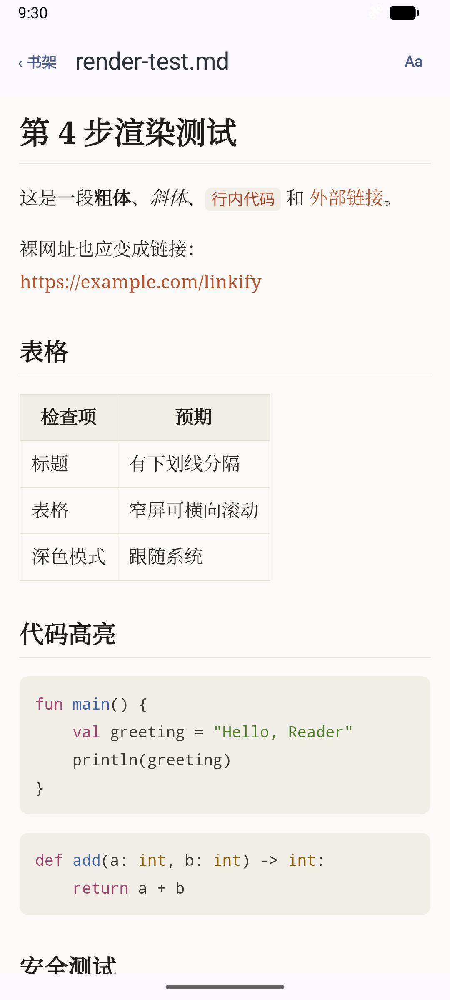
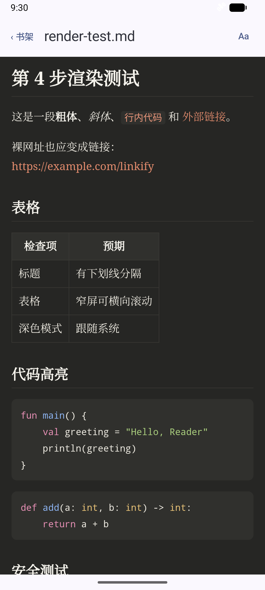
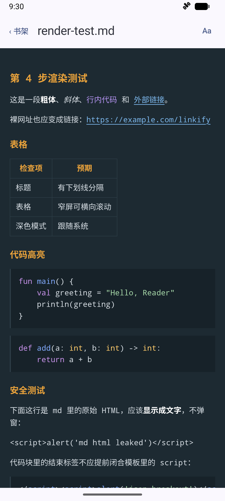

# Markdown reader themes

Date: 2026-10-15. Local device: Medium_Phone_API_37.0, 1080×2400, density 420. API 34 regression is also run by the repository CI workflow on push.

## Implementation

- Added AUTO/PAPER/INK/TERMINAL IDs and SharedPreferences ThemeStore; unknown stored IDs fall back to AUTO.
- Adopted the supplied CSS-variable template and JSON renderer. Theme replacement precedes insertion of user Markdown, preserving literal `__THEME__` in the document.
- The Aa menu appears only for Markdown. HTML gets a null theme parameter, so even an HTML page defining its own `setTheme()` is left alone.
- A theme change keeps both the WebView instance and document alive. The template preserves the current pixel scroll offset when changing CSS.
- The native theme boundary validates IDs and JSON-encodes the JS argument. The page also rejects unknown IDs.
- `rememberUpdatedState` supplies the latest selection to `onPageFinished`, supplementing the live-change effect when a selection arrives before page scripts are ready.
- Removed the two obsolete GitHub highlight CSS assets; highlight.js and its BSD-3-Clause license remain bundled. No dependency or network-permission change.

## Local automated verification

Command:

```bash
JAVA_HOME='/Applications/Android Studio.app/Contents/jbr/Contents/Home' ./gradlew :app:testDebugUnitTest :app:connectedDebugAndroidTest :app:lintDebug :app:assembleDebug --no-configuration-cache
```

BUILD SUCCESSFUL. Download-free local XML reports checked: **21 JVM + 30 instrumented tests**, zero failures/errors/skips. This adds the supplied 6 JVM cases and 5 device cases to the original 40; repeated runs do not add to this count. Lint: zero errors, 18 warnings (the new advisory is SharedPreferences `UseKtx`). Debug APK permission list checked with `aapt2`: no INTERNET permission.

The 5 new device cases cover:

1. All four menu choices, same WebView identity and JS sentinel, 600 CSS-pixel scroll position, no document-wide horizontal overflow, independently scrollable wide tables, theme-consistent highlighting, terminal list/quote markers, heading sizes and underlined links and invalid JS theme rejection.
2. Ink on a light system has dark code blocks; AUTO tracks both system modes; Paper stays light on a dark system.
3. Theme selection survives closing and reopening the Activity with a new ViewModel.
4. HTML has no Aa control and its own `setTheme()` is never called.
5. Initial live theme differs from the template default and still applies after page load; a malicious native theme string cannot execute JS.

Two regression failures were observed before accepting the implementation: the old app fails the new missing-Aa assertion; temporarily removing the page-finished theme callback makes case 5 time out waiting for Ink, demonstrating that an initial LaunchedEffect alone is insufficient. The callback was restored before the full passing run.

Existing Markdown safety/rendering and sandbox cases pass: both alert payloads remain inert, remote images are blocked, external links hand off to a browser, and sandbox opening/reopening remains 9/9. The two prior highlighting assertions now expect Paper/Ink palette colors rather than the deleted GitHub CSS colors. The temporary-INTERNET positive-control round is historical acceptance evidence, not a new claim about this run.

## Manual and visual verification

Installed the normal debug APK after instrumentation. Opened `render-test.md` from the sample shelf, selected Terminal, recorded a running PID, force-stopped the app, verified the process exited, cold-started and reopened the document. A new PID was present; SharedPreferences retained `terminal` and the native menu showed `✓ 终端`. The demo selection was then reset to AUTO.

The sample shelf was restored from its existing backup after the device test runner's app installation/cleanup. The displayed fixture is the existing rendering test document.

| Paper | Ink on a light system | Terminal |
|---|---|---|
|  |  |  |

These are unedited native emulator screenshots. Demo status bar: 09:30, full battery, notifications hidden; demo settings restored after capture. App-bar recoloring and optional fonts remain out of scope.

## Terminal heading revision

Removed the six heading-prefix pseudo-elements. H1 is now 1.3em, H2 is 1.15em, and H3–H6 remain 1em; amber and bold are retained. List `-` and quote `>` markers remain unchanged.

The existing theme-switch device case now checks all six heading levels, sizes, amber/bold styling, unchanged list/quote markers and link underlines, along with its existing no-reload/scroll assertions. It failed against the old prefixes before the CSS change. The revised case passes locally on API 37; the repository CI runs the full suite on API 34. No test cases were added, so the total remains 51. The Terminal screenshot is refreshed for this revision.
