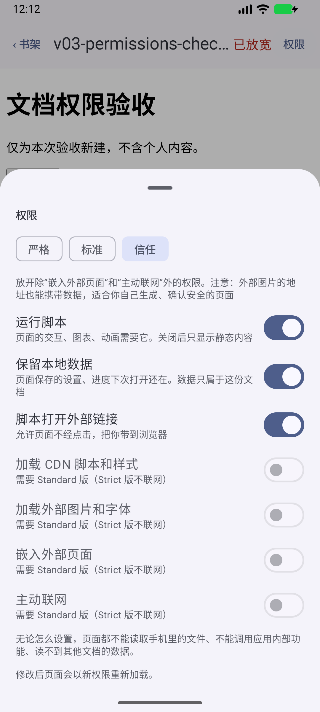

# v0.3.0 reading controls and document permissions

This integrates the supplied v3 reading controls and v4 permissions by merging them with the existing cancellation, progress-write, EPUB-link and R8 fixes. Version `0.3.0` / code `4`; namespace unchanged, application ID `io.github.zer0rin.yhviewer`; Room schema 3 is committed with migrations 1→2→3.

## Implemented behavior

- TXT / EPUB: stable full-screen body, overlay bars, confirmed taps to turn 90% of the viewport, previous chapter end, persistent font/line/margin/theme/paging/keep-awake preferences. TXT updates CSS in place; EPUB reloads at a relative position with JavaScript disabled.
- HTML: per-document permissions, three presets, explicit warning for relaxed permissions, shelf document sheet and reader permission sheet. Trusted includes scripts, persistent data, scripted external links, CDN and external media; **iframe and active networking are excluded** and require manual grants.
- Strict edition never has INTERNET. Standard edition has INTERNET but uses the default no-network policy unless a document receives explicit grants. Both use the same application ID and signing configuration.
- Each render uses an independent ephemeral Profile. Persistent Profiles use durable generation names; revocation invalidates the name immediately, even while a live WebView prevents deletion. Disposal/startup retry physical cleanup. AndroidX also prohibits deleting a Profile loaded in memory, so disk cleanup can wait until the next process start. Unsupported engines disable persistence and iframe access and use a unique per-render origin; retired origins are cleared. A unique main-document origin alone cannot isolate the storage of third-party iframe origins.
- New grants and edits are bounded by the current edition and WebView capabilities before saving. Existing stored grants are not rewritten merely by opening a document; an explicit Standard grant can remain dormant in Strict. Selecting Trusted in Strict cannot silently grant future Standard networking.
- Cookies, device file/content access, JS bridges and service-worker networking remain unavailable. Local documents also forbid workers and plugins in CSP.

## Explicit security boundaries

No native HTTP proxy is used. Third-party iframe documents do not inherit the parent CSP and may communicate independently when frames are permitted. The iframe switch says so and is excluded from Trusted. Image/media/iframe URLs and scripted browser navigation can carry data out; disabling parent fetch/XHR/WebSocket does not promise confidentiality after those grants. Only Strict's absent OS permission rules out networking by the app itself.

## Verification status

Local verification uses the dedicated `YHViewer_V03_Test` API 37 emulator, serial `emulator-5556`. All test documents are synthetic. The existing emulator and physical phone documents are not used, wiped or modified.

| Check | Result |
|---|---|
| JVM tests | 117 per edition, 0 failures |
| Lint and debug APKs | Both editions pass |
| R8 optimized release build | Both editions compile; locally signed with debug certificate for disposable-device tests only |
| Final APK permission gate | Strict absent / Standard present, debug and release APKs |
| Negative permission gates | Opposite flavor and unknown flavor rejected |
| Latest permission/UI regression | Strict 5/5 and Standard 7/7 pass on API 37 |
| Default sandbox with real INTERNET | Native HTTPS positive control 200; open + reopen both 9/9 |
| Migration tests | 1→2, 2→3 and 1→3 pass |
| Reading regression | Full suite passes; publisher fixed-size EPUB paragraphs also reflow at 150% with JS off and ratio preserved |
| Standard full device suite | 54/54 pass on API 37 |
| Strict full device suite | 52 pass, 2 intentionally skipped Standard-only network tests, 0 failures on API 37 |
| Optimized startup / cross-flavor install | Both editions cold-start and render the native shelf. Strict↔Standard keeps a synthetic TXT copy and chapter 2 after its source is deleted |
| API 34 CI / v0.3 physical device | Pending; earlier v0.2 results are historical only |

The permission tests exercise the real Chromium CSP and production request interceptor. Deterministic fake HTTPS bodies are supplied only after that interceptor grants a request. One test proves the approved iframe boundary: child fetch succeeds while parent fetch is blocked. Other checks cover isolated storage, ephemeral reopen, immediate revoke/regrant while the old Profile is still live, native WebView settings and exact private-origin port/host guards.

The first complete Standard run exposed delayed-scroll timing and a confirmed-tap callback hitting a destroyed EPUB WebView. The implementation now captures native position before reflow, cancels pending restoration on real touch, records a link before navigation, and invalidates delayed gesture callbacks on release. Tests wait for position acknowledgement before backgrounding. A further theme regression came from delaying `scrollTo(0, 0)` on a fresh document: that overwrote early scrolling. Fresh zero-position documents no longer schedule that restoration; the formerly failing theme test now passes. The final Standard full suite passed 54 cases; Strict passed 52 and skipped the two tests that specifically require Standard networking. A code-width check now waits for asynchronous viewport layout before asserting; it retains the original horizontal-overflow requirement.

The first API 34 CI device run failed: the older WebView lacks Profiles, JUnit assumptions were reported as failures by the runner, and UI cases lacked window focus. Standard-only cases now compile only in the Standard test source set; the common storage case verifies ephemeral fallback on unsupported engines, and the iframe case verifies its capability denial. CI compiles before waking and unlocking its single dedicated emulator, runs each edition separately, and retains screenshot/window/power diagnostics on failures. The second API 34 run passed all capability, fallback and focus cases; Strict had 50/52 pass and Standard 52/54, with the same two book-theme cases failing. Both failures were reproduced locally at 320dp: the test clicked a chip outside the horizontal viewport and dismissed the sheet instead. Scrolling the chip into view and asserting selection makes both cases pass on that narrow local screen. The original theme and position assertions remain. Final API 34 revalidation is pending.

CI now runs unit/Lint/debug and device suites for both editions. Release builds both R8 APKs, checks signature/application ID/version/edition permission, smoke-starts both and publishes APKs plus SHA256 only after those gates. No v0.3 tag has been pushed by this integration.

## Native UI evidence

All screenshots below come from the optimized local builds on the disposable API 37 emulator and newly generated documents. They contain no phone documents.

| Reading settings | Strict capabilities | Standard Trusted preset |
|---|---|---|
|  |  |  |

Trusted visibly leaves iframe and active-network switches off, and shows the URL-data warning. Strict visibly disables the four networking permissions and explains that Standard is required.
